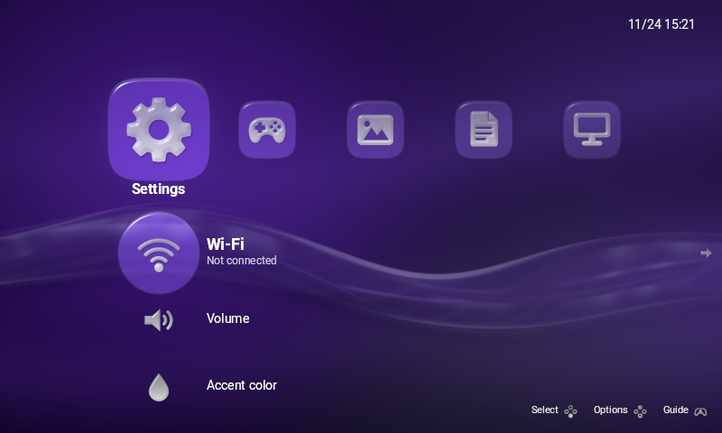

# Pixi: Pi Cross Interface

A console-style Wayland session for the **PSPi** and other Raspberry Pi handhelds, written in C.


Pixi is two programs:

- **`pixi`**: a Wayland compositor built on wlroots 0.18. It shows every application full
  screen, one in front at a time, the way a console does. X11 applications run through
  XWayland.
- **`pixi-shell`**: the interface. It draws the home screen (categories across, items
  down), the Guide overlay over a running game, and the launch screen in between.
  It uses OpenGL ES 3.

Its look follows [LineXinBar](https://github.com/Petexy/LineXinBar), using LineXinBar's
own pieces: the same layout measurements, theme colors, glyphs and menu sounds, and
its GPU materials (glass panes that bend the wallpaper behind them, glyphs shaded like
beads of water, the silk and water currents) ported from WGSL to GLSL. See
[NOTICE.md](NOTICE.md).

| | |
| --- | --- |
|  |  |
|  |  |

## What's in it

- **Home screen.** A PSP-style crossbar: **Settings | Apps | Pictures | Music | Videos | Games**.
- **Apps.** Everything else installed, in a folder per kind (Internet, Utilities, and
  so on), or listed directly when there are only a few.
- **Files.** First in Settings: browse Home, USB drives and the whole device. Pictures, music and
  videos open in the viewer and players. Options deletes a file or an empty folder, asking first.
- **Pictures.** Folders and photos with thumbnails. A full-screen viewer with
  Left/Right to flip through, a slideshow, and EXIF rotation. JPEG, PNG, BMP, GIF, WebP.
- **Music.** Play a song, a whole folder, or shuffle. A Now Playing screen with
  title, artist, album, a progress bar, repeat, shuffle and skip. Music keeps playing
  while you browse. MP3, Ogg, Opus, FLAC, WAV.
- **Videos.** Played in Pixi's own video player, full screen, with VLC (libvlc) doing the decoding. The videos in a folder form a
  playlist, and the next one starts when one ends. Subtitle files beside a video are found
  automatically.
  - **D-pad left/right** skip 10 seconds back or forward; **L / R** skip a minute (`video_skip` and
    `video_skip_long` in `pixi.conf`). **Up/Down** change the volume.
  - The **bottom button** (X on the PSPi) plays and pauses, and so does Start. The **right button** closes
    the player. **Square** steps through the subtitles.
  - **Triangle** opens the options on the right: previous and next video, audio track, subtitles, subtitle
    size, playback speed, picture (original, 16:9, 4:3, zoom to fill, stretch), repeat, video info.
  - Leaving for the Home screen or the Guide pauses it; it stays in the Guide as a card until you close it.
  - VLC hands Pixi each picture as raw YUV, and Pixi turns it into color and scales it on the GPU, so the
    CPU only decodes. Videos decode in software by default (`video_hwdec = auto` lets VLC try the
    hardware). If the built-in player can't start, the outside player in `video_player` (VLC) is used.
  - If the shell ever goes down, `~/.cache/pixi/crash.log`, `shell.log` and `vlc.log` say why.
- **USB drives and cards.** Pictures, Music and Videos also look in a folder of that
  name (Pictures may be DCIM) on anything mounted under /media. More folders can be
  added in pixi.conf under `[media]`.
- **Games.** Steam Link and RetroArch first, then your game library: one folder per
  system, each game launched straight into its emulator core.
- **Guide.** Opens over whatever is running:
  - What's playing, with the running app visible in a card beside the menu.
  - Resume, Close, and Switch to each other running app. The Web Browser, the Music player and the Video
    player show up here as apps too, with the page, the track or the picture in their cards.
  - Quick tiles and a volume bar.
  - A power menu: Log out, Restart, Shut down.
- **Settings.**
  - Network: Network Settings pages laid out like the PSP's (see below).
  - Volume and brightness.
  - Layout: the accent color and the wallpaper, in one list on the right. At the top, *Choose Wallpaper ...* opens
    the wallpaper picker; below a line come the 21 accent colors (LineXinBar's nine palettes plus Silver, Gold,
    Lime, Emerald, Cyan, Sky, Violet, Fuchsia, Rose, Crimson, Brown and Slate).
  - Wallpaper: the original moving background, or any picture from Pictures (the picker opens like Pictures, with
    thumbnails). The picture is cropped to fill the screen and darkened a little so the menus stay readable. In
    Pictures, the Options button on a picture also offers *Set as wallpaper*.
  - Information Bar (the clock, date and battery at the top of the screen): one list on the right with a
    Battery percentage switch (it flips where it is and the list stays open), a line, 12 Hour or 24 Hour, a line,
    then the date format (1/25, 25/1, 2026-01-25 or Sun. Jan. 25).
  - Power: log out, restart, shut down.
  - Update: a list on the right with
    - Update OS: checks for updates and installs them in an on-screen dialog with a progress bar
      (the installer allows apt-get without a password for your account via /etc/sudoers.d/pixi-apt).
    - Update Pixi: runs `install.sh` from `/boot/firmware/install` again, with no questions, on its own progress
      page, then offers to restart. Copy a new `install.sh` and `pixi-src.zip` there first.
  - Servers: a list on the right with FTP Server (below) and Web Server (below), then Edit Web Config, Reload Web Server and Restore Default Config.
  - Menu sounds, confirm button, refresh, system information (one screen).
  - Gamepad tester: a PSP outline that lights up each button as it's pressed (d-pad, face buttons, L1/L2/R1/R2, Select, Start, Home, Volume, Mute) and shows both analog sticks. Hold Back for a second to leave. Every press is written on the tester's screen with the input device's name and the key or button number, and the screen says how many input devices are being read (or that they can't be read, which means the account isn't in the `input` group). The tester also reads the PSPi driver's shared memory (`/dev/shm/my_shm`), which holds the raw state of every button on the board. That is how HOME, SELECT, START, VOL+, VOL- and MUTE light even when SDL or the input devices don't report them, and how DISPLAY lights: the driver never turns DISPLAY into a key press (the board changes the brightness itself), so the tester lights it for half a second whenever the brightness level changes. Outside the tester, HOME opens the Guide and the volume buttons change the volume in 5% steps (MUTE toggles it) with a small bar on screen.
- **One material.** Pixi uses LineXinBar's Simple look (silk ribbons, flat marks), which is
  light enough for a Pi. The Full water-and-glass look was removed.

## Install on the PSPi

Pixi needs **Raspberry Pi OS Lite (64-bit) based on Debian 13 "Trixie"**, which ships
wlroots 0.18. The older Bookworm release isn't supported.

1. Flash Raspberry Pi OS Lite (64-bit) with Raspberry Pi Imager, setting up Wi-Fi and a
   user. Get the PSPi's screen and controls working on the console first.
2. Copy this folder to the Pi (or `git clone` it), then:

   ```sh
   cd pixi
   sudo sh install.sh
   sudo reboot
   ```

The installer:
- installs wlroots, Mesa, SDL2, XWayland, fonts, NetworkManager, PipeWire, RetroArch
  with emulator cores and Steam Link;
- builds Pixi on the Pi;
- logs your user in on tty1 and starts Pixi at boot.

Options: `--no-autostart` (start it yourself with `pixi-session`) and `--no-steamlink`.
Run it again to update.

## Controls

| Control | Action |
| --- | --- |
| D-pad / left stick | Move. Left and right change category; in a submenu, left goes back |
| A (bottom) | Select / start |
| B (right) | Back |
| Y / Select | Details |
| L / R | Jump up / down 6 items (the lists also wrap around at the ends) |
| **L + Triangle** together, **Select + Start** together, or a Guide button | Open or close the Guide |
| Keyboard | Arrows, Enter, Esc, Tab; **Super** or **Home** for the Guide; Ctrl+Alt+Backspace ends the session |

Swap A and B (the Japanese layout) in **Settings → Confirm button**.

If the PSPi's built-in controls aren't recognized as a controller, the shell uses the
raw button numbers in `[input]` in `~/.config/pixi/pixi.conf`. Run
`pixi-shell --debug-input` to see which numbers your buttons send.

## Games

Games has two folders, **Console** and **PC**, after Steam Link and RetroArch. Copy games in on
the PSPi or over File transfer (FTP), where they're under `Games`.

- **Console:** `~/Games/roms/<system>/`. The folders are `nes snes gb gbc gba md sms gg pce psx
  psp nds n64`, and Pixi creates them. Console lists the systems that have games, and each opens
  its game list.
- **PC:** `~/Games/pc/<game>/`, one folder per game with its program inside, e.g. `Games/pc/Doom/doom`
  or `Games/pc/Quake3/quake3`. Pixi runs, in this order: a `start.sh` (or `run.sh`, `launch.sh`) if
  there is one, the program named like the folder, a program with the folder's name in it
  (`ioquake3.aarch64`), or the folder's only program. Libraries and programs built for another kind
  of machine are skipped. The game runs from its own folder, so it finds its data files there, and
  files copied over FTP don't need to be marked executable. An `icon.png` (or `cover.png`, or
  `Doom.png` for Doom) becomes its icon. Triangle > App Settings sets its controls (Gamepad or
  Keyboard + Mouse), like other apps.
- Older layouts (`~/roms`, or system folders straight under `~/Games`) are moved into
  `~/Games/roms` once, and `~/roms` is left as a link to it. A system appears under Games once its
folder has something in it. If an emulator core is missing, the game tells you which
package to install.

## Steam Link

Keep Steam running on your PC and start **Steam Link** from Games. The first time,
choose your PC and type the PIN Steam Link shows into Steam on the PC. The PSPi's
controls go to the PC as a controller. Open the Guide (Select + Start) to switch back
to Pixi without closing it.

## Configuration

`~/.config/pixi/pixi.conf`. Every option is described in [pixi.conf](pixi.conf):
theme, material, UI scale, screen rotation, extra systems and extra launcher
entries. Log out (Guide → power → Log out) and back in after editing.

## Building

Layout (Settings) ends with **Light Mode for Apps** and **Dark Mode for Apps**, after the colors. The choice is saved as `app_scheme` in `~/.config/pixi/state`, written into GTK 3 and 4's `settings.ini` (`gtk-application-prefer-dark-theme`), set as the desktop color scheme with `gsettings` (which GTK 4 and Chromium read), and passed to apps Pixi starts as `GTK_THEME=Adwaita:dark` or `Adwaita:light`. Until one is picked, apps are left as they are. Qt apps may ignore it. In every side list (Options, Layout), Up on the first row goes to the last and Down on the last goes to the first.

Apps are sized to fill the screen but are told they are maximized, not full screen, so Chrome and similar programs keep their tabs, address bar and menus. An app that asks to go full screen (a video, F11) is allowed to, and can leave it again. Only Pixi's own shell is full screen. (This is in the compositor, so it needs rebuilding on the device.)

The version number shown in System Information and by `--version` is the build date in UTC (for example `2026.11.27`), set by the Makefiles when Pixi is compiled, so each day's build has its own version. Set `PIXI_VERSION=...` on the `make` line to override it.

```sh
sudo apt install build-essential pkg-config libwlroots-0.18-dev libwayland-dev wayland-protocols \
    libxkbcommon-dev libsdl2-dev libsdl2-ttf-dev libsdl2-image-dev libsdl2-mixer-dev libgles-dev libvlc-dev libqrencode-dev
make
sudo make install          # to /usr/local; then run pixi-session from a text console
```

To try it inside another Wayland desktop, run `pixi` there; wlroots opens it in a window.

The glyph distance fields in `assets/glyphs` are generated from `assets/glyphs-src`
with `tools/make-sdf.py` (needs rsvg-convert, NumPy, SciPy and Pillow).

## How it fits together

```
pixi (compositor) ──starts──▶ pixi-shell ──starts──▶ Steam Link, RetroArch, apps
        ▲                         │
        └── pixi_shell_v1 ────────┘   window list, front window, mode, guide key;
                                      set mode (home / overlay / app), activate, close, quit
```

`protocol/pixi-shell-v1.xml` defines the private protocol. The compositor offers it
only to the shell process it started, checked by process ID.

## Known limits

- The Guide's card shows the middle of the running app at full size, cropped, rather
  than a scaled-down picture of the whole app.
- Built and tested on a desktop Linux machine and on wlroots' headless backend, not
  yet on a PSPi. Performance on the Pi's GPU is untested.

## License

GPL-3.0-only. See [LICENSE](LICENSE) and [NOTICE.md](NOTICE.md).


## Guide button and app switcher

In the Guide, L jumps to the side bar and R jumps to the app switcher.

Press the Guide button (or Super) anywhere to open the Guide: a sidebar with the clock, quick tiles,
volume, the music player, and power options, next to a switcher that shows a live preview of each
running app plus the Home screen. Choose a card to switch to it, or close it from the sidebar.

## App Store

Settings > App Store browses a curated catalog of Raspberry Pi OS apps with a sidebar (Home, Search, Updates,
Installed, Everything and categories). The catalog is checked against the system's package lists, so only
apps your system can install are shown. Open an app to see details, then Install, Update, Open or Remove.
Pi-Apps is part of the store on a Raspberry Pi: its apps (the ones that need an installer script; plain apt
packages are already here) show up in the same pages, categories, Installed and Search, with their own icons.
Install and Remove run Pi-Apps' own `manage` script in the same progress dialog. Until Pi-Apps is on the device,
"Add Pi-Apps" (on Home and Everything) downloads and runs its official installer, then asks nothing more. Its apps
install without pop-up windows, and Open finds the app's entry in Apps. Pi-Apps updates aren't in the store's Updates
page; use Pi-Apps itself for those. Pi-Apps' scripts use sudo themselves. When sudo asks for a password, Pixi's on-screen password box opens over the progress dialog. The password is kept in memory only until that install ends, so the many sudo calls inside one install don't each ask again. Only if no on-screen password helper is set up do installs open in Pixi's Terminal instead. Some Pi-Apps installers ask a question with a yad window (Chrome asks which version to install). Such a window can't be reached with the gamepad, so during a Pi-Apps install Pixi stands in for `yad` (a link to itself in `~/.cache/pixi/bin`) and shows the question in its own dialog: Up/Down to move, Confirm to tick a version or press OK, Start to accept, Back to cancel. If an install fails, the dialog shows the last lines of Pi-Apps' output, and the whole log is in `~/.cache/pixi/piapps-app.log`. Set `PIXI_PIAPPS_DIR` to use a Pi-Apps folder somewhere else.

Icons of apps that aren't installed yet are downloaded once from Debian's package icon set (about 25 MB, kept in
`~/.cache/pixi/store-icons`) and appear as they arrive; apps with no icon in that set keep a lettered tile.
Installs run through apt in the same progress dialog as Update OS and need passwordless sudo
(the default on Raspberry Pi OS). Press Options (north button) from anywhere in the store to search
every package by name.

## Options menu, accent color and file transfer

- The Options button (triangle on a PSP-style pad) opens a list on the right side of the screen. In Files it offers
  Open, Copy, Cut, Paste, Rename, Duplicate, New folder and Delete. Delete always asks first, and "No" is the default.
- Settings > Network opens Network Settings, laid out like the PSP's but in Pixi's look:
  - *Select a connection to edit.* lists a Wi-Fi On/Off row, **[New Connection]**, and the saved connections (the
    one in use first, marked Connected). Selecting a saved one shows its details: connection name, status, signal
    strength, SSID, BSSID, channel, security, IP address, gateway and DNS. The Options button (on the list or the
    details) offers Connect or Disconnect, Change password, Details and Delete.
  - **[New Connection]** opens *WLAN Settings*: **Scan** shows a table of access points (SSID, Security, Signal
    Strength; Start scans again), and selecting one connects, asking for its password if it needs one.
    **Enter Manually** asks for the network name (SSID), then its password (empty for an open network), for a
    network that doesn't show up in a scan.
- Settings > Layout shows the colors in the same right-hand list (under *Choose Wallpaper ...*) and previews each one as you move through it.
  Confirm keeps it; Back puts the old color back.
- Settings > Servers > FTP Server starts a small FTP server, like the PSP's USB Mode. It runs as an app of its own:
  Back goes to the home screen and leaves it serving, it has a card in the Guide (with its address), and Start on its
  page (or Close in the Guide) stops it. Connect from another computer to the address shown, using your account name
  and its password. It shows only the Pictures, Music, Videos, Games, Documents, Downloads and www folders of your home folder (they're created if missing; Pixi looks for media in the first three and for games in Games: Games/roms for consoles, Games/pc for PC games). The port is `ftp_port` in `pixi.conf` (2121 by default). FTP doesn't encrypt passwords, so use it only
  on a network you trust.
- Settings > Servers > Web Server runs nginx with PHP (php-fpm), as you, serving `~/www` (created if missing, with a first
  page, and shared over FTP beside Documents and Pictures). Like FTP it is an app of its own: Back leaves it serving,
  it has a card in the Guide with its address, shows a QR code of that address (from the device's IP) so a phone or tablet can scan it, and Start (or Close in the Guide) stops it. If nginx isn't installed
  Pixi offers to install it with PHP; the installer does this too and turns off the system's own nginx and php-fpm
  services, since Pixi starts its own. Triangle on the page (or *Edit Web Config* in the Servers list) opens the settings
  file `~/.config/pixi/nginx/nginx.conf` in Pixi's own editor: a monospaced text box, the PC
  keyboard on screen for a gamepad (or a real keyboard), Ctrl+S to save and Ctrl+X to close (the on-screen Ctrl key works too), and Start to save too. Saving
  shows a Saved dialog, checks the file with `nginx -t` and loads it if the server is running; a mistake is shown and the
  server keeps the old settings. Square on the page (or *Reload Web Server*) loads it again, and *Restore Default Config*
  writes a fresh file. The file is written once, the first time the server starts, and is never overwritten (a file from
  before port 80 has its `listen 8080;` line moved to 80, once). The default listens on port 80; the installer allows it
  by letting normal users listen on ports from 80 up (`/etc/sysctl.d/99-pixi-web-port.conf`). `web_port` in `pixi.conf`
  sets the port for a new file. The server serves `index.php`, `index.html`
  and `index.htm`, and sends `.php` to php-fpm. Logs are in `~/.cache/pixi/nginx` (`error.log`, `access.log`,
  `php-error.log`). Anyone on your network can open the pages, so keep private files out of `www`.
- The HOME (guide) button is also read straight from `/dev/input`, so controllers that SDL doesn't report it for
  (BTN_MODE) still open the Guide. Your account needs to be in the `input` group, which Raspberry Pi OS does by default.


## Web browser

Apps > Web Browser runs Chromium without a window of its own and draws the page inside Pixi, always full screen. The tab
list is on the left and the menu is on the right. The menu starts with the address (select it to type) and a row of
Home, Back, Forward and Reload buttons; move along the row with left and right. Chromium is installed by the installer; if it's
missing, Pixi offers to install it. Set `browser` in `[input]` of `pixi.conf` to use a different one.

| Control | Action |
| --- | --- |
| Left stick | Move the pointer. Pushing against the top or bottom edge scrolls |
| Right stick, D-pad up/down | Scroll |
| A (bottom) | Click. A text box opens the on-screen keyboard; Start on the keyboard also presses Enter |
| Square (X) | Tab list: Select switches, Triangle closes a tab, "New tab" opens one |
| Triangle (Y) | Menu: address, back, forward, reload, start page, bookmarks, history, new tab, text size, desktop/mobile sites, full screen, clear cookies and cache |
| L / R | Back / Forward |
| B (right) | Back a page; with nothing to go back to, return to the home screen (the browser keeps running) |
| Start | Type an address or a search |

Bookmarks (`bookmarks.txt`) and history (`history.txt`) are kept in `~/.config/pixi`, and the bookmarks are also the
tiles on the start page. Downloads are refused for now. Passwords are shown as dots on the keyboard.

## Terminal

Apps > Terminal opens Pixi's own terminal (there's no separate terminal program to install). It runs your shell in the
home folder, understands what text-mode programs such as `htop`, `nano`, `vim`, `mc` and `ncdu` expect (colors, full-screen
screens, UTF-8 and box drawing) and keeps 2000 lines of history. The on-screen keyboard is always shown, docked under the
screen, so the terminal is never hidden behind it. It's the same PC keyboard as everywhere else (see On-screen keyboard
below), and every key works here: Ctrl, Alt, Fn and the F keys, Esc, Tab (Shift+Tab goes back), the arrows, Home/End,
Delete/Insert and Page Up/Down. Hold Square and push a stick to scroll back through the history (R + Pg does it too;
typing anything returns to the bottom). Hold R and press C to stop a program.

| Control | Action |
| --- | --- |
| D-pad | Move over the keys |
| A (bottom) | Press the key (holding repeats Backspace, Delete, space and the arrows) |
| B (right) | Delete |
| Square (X) | Space (when tapped on its own) |
| Square + D-pad | The arrow keys (they repeat while held) |
| Square + either stick | Scroll back / forward through the history (push further to go faster) |
| Triangle (Y) | Delete (Backspace) |
| Start | Tab |
| L (held) | Shift; tap twice for Caps Lock |
| R (held) | Ctrl; tap twice for Alt on the next key |
| L + R (held) | The number block becomes F1 to F12 (F1-F4, F5-F8, F9-F12 down its rows) |
| Guide button | Switch to something else; the terminal keeps running. It has its own card in the Guide, where Close ends it |

Typing `exit` closes it. Command-line apps (the ones marked `Terminal=true`, and htop and friends from the App Store)
open in it too; if the terminal is already busy it asks you to close it first. A USB keyboard types straight into it.

GParted needs root and normally asks polkit, which the Lite image doesn't have. Its *Allow Auto sudo* app
setting is on by default (see App Settings below), so Pixi starts it through `sudo` and lets root onto Pixi's
display (with `xhost`).

## Boot, shutdown and restart screens

The installer sets up a Plymouth theme (`assets/plymouth/pspi`) so the PSPi shows a "PSPi / Raspberry Pi
Interface" screen while it starts, and "Shutting down..." or "Restarting..." when it stops, instead of
console text. It also adds `quiet splash loglevel=3 vt.global_cursor_default=0 logo.nologo` to
`/boot/firmware/cmdline.txt`, `disable_splash=1` to `config.txt` (backups end in `.pixi-backup`), and
a `~/.hushlogin`. Plymouth closes itself as the login console starts, and `pixi-session` makes sure it is gone. Redraw the pictures with `tools/make-splash.py`.

To get the text back, edit `cmdline.txt` on a PC (the boot partition) and delete `quiet splash`, or
restore the `.pixi-backup` copy.

## On-screen keyboard

Triangle is a second Backspace on both keyboards (unlike B, it never closes a text box).

Anywhere Pixi needs text (Wi-Fi passwords, renaming, the App Store search, the browser) and in the terminal, the
keyboard is a PC keyboard in the theme's colors. The main block is laid out like a 75% keyboard: Tab, Caps Lock, Shift and
Ctrl rows, Backspace at the end of the top row, one Pg key by Enter (Page Up; with Shift, Page Down), Home/End beside the
up arrow, and a Home key (it opens the Guide from the terminal), Alt, Fn and the arrows along the bottom. Beside it, a
block like a number pad holds Fn, Delete/Insert, `` ` ~ `` and Esc, then the number row as 7 8 9 -, 4 5 6 = and 1 2 3 0. The keys with two symbols show both; the one that will be typed is brighter.

- **D-pad** moves (left and right run on into the other block), **A** presses the key, and **B** deletes (it closes a text
  box when the text is empty).
- **L** is Shift while you hold it; tap it twice quickly for **Caps Lock** (twice again turns it off).
- **R** is Ctrl while you hold it; tap it twice quickly for **Alt** on the next key.
- **L and R together** turn the number block into **F1 to F12**, in reading order: F1 to F4 on the 7 8 9 - row,
  F5 to F8 on 4 5 6 = and F9 to F12 on 1 2 3 0. The Fn key does
  the same for the next key, and the on-screen Shift, Ctrl and Alt keys work for the next key too.
- In a text box, **Square** types a space and **Start** is Done/Go. Keys that do nothing in a
  text box (Ctrl, Alt, the arrows, the F keys and so on) are dimmed. File names and text boxes in web pages
  capitalize the first letter automatically. **L + Triangle** still opens the Guide.
- A hardware keyboard works at the same time.

## Keyboard + Mouse mode and App Settings

Some apps have no gamepad support. Each running app can be switched between **Gamepad** (the app gets the controller as is) and **Keyboard + Mouse** (Pixi turns the controller into a pointer and keys). Programs from the Apps list, and any window Pixi didn't launch itself (such as a question window from a Pi-Apps installer), **start in Keyboard + Mouse**, because nearly all of them have no gamepad support. Games added from a PC folder start in Gamepad. Pixi's own screens always use the gamepad. Change it for one app in App Settings (*Start in*) or while it runs with the Guide's third button.

The Guide shows four buttons: Wi-Fi on/off, Bluetooth on/off, Gamepad/Mouse mode for the app in front, and **Screenshot**. Screenshot saves a picture of the highlighted app (the one picked in the Guide, or the one in front) as a PNG in `~/Pictures/Screenshots`, named like `2026-11-26_17-50-24.png`. It needs the updated compositor (protocol version 4).

Keyboard + Mouse mapping:

| Control | Action |
| --- | --- |
| Left stick | Move pointer |
| Right stick | Scroll |
| Confirm / R2 | Left click |
| Back / L2 | Right click |
| D-pad | Arrow keys |
| Square (X) | Esc |
| Start (tap) | Enter |
| Select (tap) | Tab |
| Guide button, Y+L1, Select+Start | Open the Guide (pointer is hidden there) |
| R + Triangle (Y) | Toggles Pixi's on-screen keyboard over the app (R + Triangle again, or B, puts it away). It is a real keyboard: every key you press goes to the app as a key press, and holding a key repeats it. L is Shift and R is Ctrl while held; the on-screen Shift, Ctrl, Alt and Fn work for the next key; Triangle is Backspace, Square is Space, Start is Enter, and B or R + Triangle puts the keyboard away. The pointer is off while the keyboard is up, so click the field first. Like Squeekboard on Raspberry Pi OS, the keyboard never takes the keyboard focus from the app: while it is up, the compositor keeps the app focused and sends the keys to it. |

**App Settings:** in Apps, press the Options button on an app and choose *App Settings*. The page looks like the FTP Server page. It has two options, saved in `~/.config/pixi/apps.conf`:

- *Start in* picks Gamepad or Keyboard + Mouse for that app's next launch.
- *Allow Auto sudo* starts the app as administrator (root) through `sudo`, so nothing has to be typed and no
  app has to be listed in `install.sh`. It's on by default for GParted and off for everything else.

**Hide Item.** Press Options on an app or game and tick *Hide Item* to take it off the home screen. Press Options on Settings > App Store and open *Apps List* to see every app in a tree (Files, Apps and their kinds, Games and PC games) with a check box in front of each: a ticked item is hidden, and a ticked folder hides everything in it. Settings itself is not listed. The choice is saved as `hide=on` in `apps.conf`.

**Run in Background.** Press Options on an app in the XMB and use the *Run in Background* switch. When it is off (the default for every app), the app is paused (its processes are stopped) while it isn't the one in front, so it stops using the processor, battery and sound, and it carries on from the same spot when you go back to it. When it is on (the default for music players), the app keeps running behind the home screen and other apps. An app stays awake for a few seconds after it opens, while the Guide is over it, and whenever it is closed (a paused app is woken first so it can quit). Windows Pixi didn't launch (installer questions) are never paused. Pixi's own music player isn't an app; it always keeps playing. The choice is saved as `bg=on` / `bg=off` in `apps.conf`.

**Passwords for sudo.** When sudo needs a password for an app (because of *Allow Auto sudo*, or because the app
runs `sudo` itself), Pixi shows its keyboard in a password box over whatever is on screen, and goes back to the
app afterwards. A wrong password asks again; Back or Esc cancels. It works through sudo's password helper:
`SUDO_ASKPASS` for apps Pixi starts, and `Path askpass /usr/local/lib/pixi/pixi-askpass` in `/etc/sudo.conf`
(added by the installer) for the rest. The password goes straight to sudo and is never saved. On Raspberry Pi
OS the first user usually has passwordless sudo, so the box only shows on systems set up to ask.

Note: this uses protocol `pixi_shell_v1` version 4, so the compositor and shell must be updated together (reinstall or Update Pixi, then reboot). R + Triangle opens the on-screen keyboard over the app.

## Video out (USB webcam)

Settings > **Video out** has two choices in the right-hand menu: **None** (off, the default) and **USB (UVC webcam)**.

With USB on, plug the PSPi's USB data port into a PC. The PC sees a camera called "PSPi Screen" (800x480 Motion-JPEG, up to 30 fps) that shows the PSPi's screen, including the pointer. Open it in OBS, VLC, a browser or any camera app. Nothing is captured until a PC opens the camera, so it costs nothing while idle. The choice is remembered across restarts.

How it works: `uvc/pixi-videoout` (run as root through sudo) sets up the USB gadget in configfs, and `uvc/pixi-uvc` answers the PC's UVC requests and sends it JPEGs of the screen grabbed with wlr-screencopy.

Sound: Video out also adds a USB audio device ("PSPi Audio") to the same connection, so the PC can record what the PSPi plays: choose "PSPi" as the microphone/input in OBS or the Mac's sound settings. `uvc/pixi-audio-route` copies the PSPi's speaker sound into it through PipeWire. If the USB controller can't fit audio, Video out falls back to the camera alone and says so. Logs: `/run/pixi-uvc.log` (camera, with a stats line every 5 seconds showing screen grabs per second and frames sent per second) and `$XDG_RUNTIME_DIR/pixi-audio.log` (sound).

Tuning (optional): `/etc/pixi-videoout.conf` can hold `MAXPACKET=2048` (or 3072) to try bigger USB packets, which can raise the frame rate on some boards (on this one, 3072 produced a black picture), and `QUALITY=55` (10-95) for the JPEG quality: lower makes smaller frames, which the USB link carries faster. The stats line in the log shows grabs per second, frames sent per second and the average frame size.

Notes:
- A USB port is either a host (keyboards, drives) or a device (a webcam for a PC). Choosing USB writes `dtoverlay=dwc2,dr_mode=peripheral` to config.txt, and choosing None removes it. Each change takes effect after a restart, and the menu says when one is needed. While Video out is on, the port can't be used for keyboards or drives.
- It needs a USB port that can act as a device. The PSPi's port can (a Raspberry Pi 5 board's USB-C port can't).
- `pixi-uvc --test-dir DIR` saves a few screenshots as JPEGs, and `pixi-uvc --selftest` checks the UVC handling, neither needs USB.

## Dialogs belong to their app

An app is one window plus all of its dialogs. A dialog (a window with a parent, such as GParted's partition details) shows centered on top of its app, gets the keyboard and the pointer, and is not a separate entry in the Guide's app switcher. Closing the app closes its dialogs, and closing a dialog gives the keyboard back to the app. Only the compositor changed for this, so Keyboard + Mouse mode follows the app automatically.

## System Information

Settings > System Information shows the device's details, including whether SSH is on. The SSH switch is in
Settings > Servers > Options (Triangle on the Servers row, or select Servers): it turns the system's SSH service on or
off (it needs openssh-server, which Raspberry Pi OS includes). The installer allows `systemctl enable/disable --now ssh`
without a password for your account, so run it again after updating.
