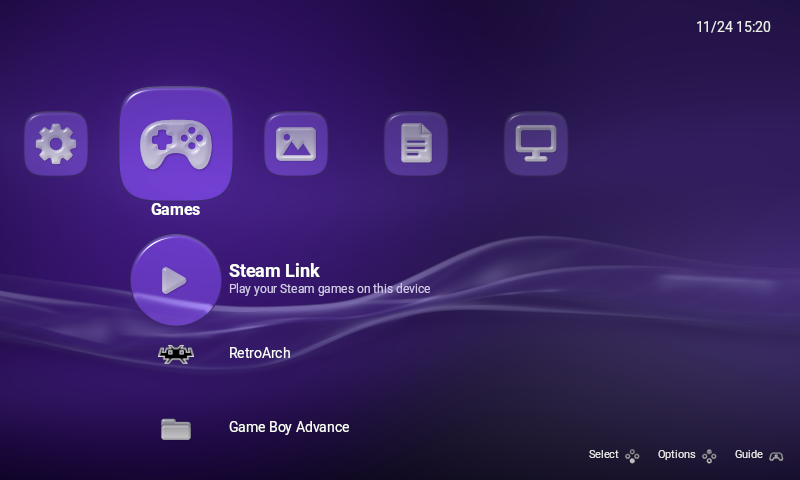
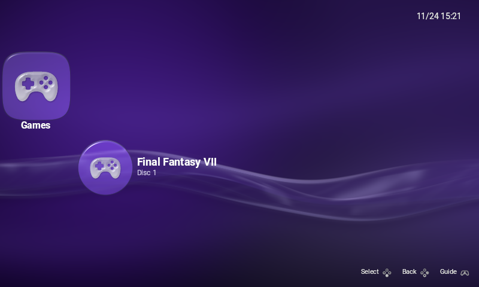
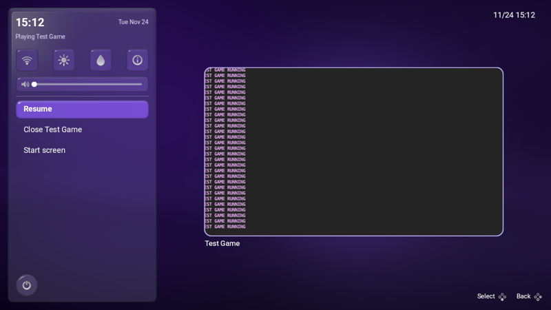
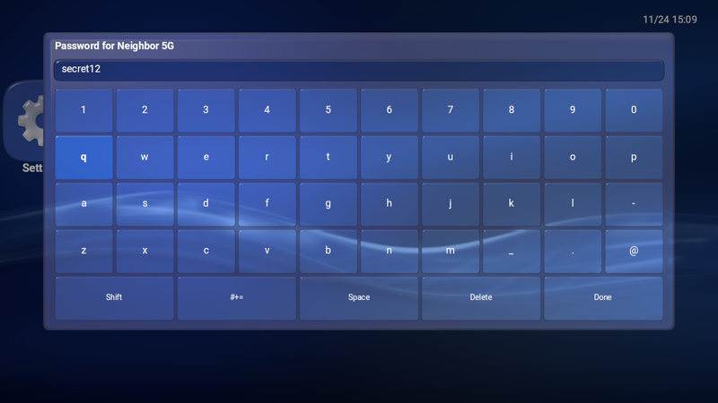

# Pixi: Pi Cross Interface

A console-style Wayland session for the **PSPi** and other Raspberry Pi handhelds, written in C.



Pixi is two programs:

- **`pixi`**: a Wayland compositor built on wlroots 0.18. It shows every application full
  screen, one in front at a time, the way a console does. X11 applications run through
  XWayland.
- **`pixi-shell`**: the interface. It draws the start screen (categories across, items
  down), the Guide overlay over a running game, and the launch screen in between.
  It uses OpenGL ES 3.

Its look follows [LineXinBar](https://github.com/Petexy/LineXinBar), using LineXinBar's
own pieces: the same layout measurements, theme colors, glyphs and menu sounds, and
its GPU materials (glass panes that bend the wallpaper behind them, glyphs shaded like
beads of water, the silk and water currents) ported from WGSL to GLSL. See
[NOTICE.md](NOTICE.md).

| | |
| --- | --- |
|  |  |
|  |  |

## What's in it

- **Start screen.** Settings, Games, and a column for each kind of installed app
  (Internet, Multimedia, Utilities, System, and so on) that has something in it.
- **Games.** Steam Link and RetroArch first, then your game library: one folder per
  system, each game launched straight into its emulator core.
- **Guide.** Opens over whatever is running:
  - What's playing, with the running app visible in a card beside the menu.
  - Resume, Close, and Switch to each other running app.
  - Quick tiles and a volume bar.
  - A power menu: Log out, Restart, Shut down.
- **Settings.**
  - Wi-Fi: scan, connect, on-screen keyboard.
  - Volume and brightness.
  - Accent color, from LineXinBar's nine palettes.
  - Theme: Full or Simple.
  - Menu sounds, confirm button, refresh, system information.
- **Two materials.** **Full** is LineXinBar's own look. **Simple** (silk ribbons, flat
  marks) is LineXinBar's mode for slow machines. By default Pixi starts in Full and
  switches to Simple by itself if frames take too long.

## Install on the PSPi

Pixi needs **Raspberry Pi OS Lite (64-bit) based on Debian 13 "Trixie"**, which ships
wlroots 0.18. The older Bookworm release isn't supported.

1. Flash Raspberry Pi OS Lite (64-bit) with Raspberry Pi Imager, setting up Wi-Fi and a
   user. Get the PSPi's screen and controls working on the console first.
2. Copy this folder to the Pi (or `git clone` it), then:

   ```sh
   cd pixi
   sudo sh install.sh
   sudo reboot
   ```

The installer:
- installs wlroots, Mesa, SDL2, XWayland, fonts, NetworkManager, PipeWire, RetroArch
  with emulator cores, Steam Link and the foot terminal;
- builds Pixi on the Pi;
- logs your user in on tty1 and starts Pixi at boot.

Options: `--no-autostart` (start it yourself with `pixi-session`) and `--no-steamlink`.
Run it again to update.

## Controls

| Control | Action |
| --- | --- |
| D-pad / left stick | Move. Left and right change category; in a submenu, left goes back |
| A (bottom) | Select / start |
| B (right) | Back |
| Y / Select | Details |
| L / R | Page up / down |
| **Select + Start** together, or a Guide button | Open or close the Guide |
| Keyboard | Arrows, Enter, Esc, Tab; **Super** or **Home** for the Guide; Ctrl+Alt+Backspace ends the session |

Swap A and B (the Japanese layout) in **Settings → Confirm button**.

If the PSPi's built-in controls aren't recognized as a controller, the shell uses the
raw button numbers in `[input]` in `~/.config/pixi/pixi.conf`. Run
`pixi-shell --debug-input` to see which numbers your buttons send.

## Games

Copy games into `~/roms/<system>/`. The folders are `nes snes gb gbc gba md sms gg pce psx
psp nds n64`, and the installer creates them. A system appears under Games once its
folder has something in it. If an emulator core is missing, the game tells you which
package to install.

## Steam Link

Keep Steam running on your PC and start **Steam Link** from Games. The first time,
choose your PC and type the PIN Steam Link shows into Steam on the PC. The PSPi's
controls go to the PC as a controller. Open the Guide (Select + Start) to switch back
to Pixi without closing it.

## Configuration

`~/.config/pixi/pixi.conf`. Every option is described in [pixi.conf](pixi.conf):
theme, material, UI scale, screen rotation, extra systems and extra launcher
entries. Log out (Guide → power → Log out) and back in after editing.

## Building

```sh
sudo apt install build-essential pkg-config libwlroots-0.18-dev libwayland-dev wayland-protocols \
    libxkbcommon-dev libsdl2-dev libsdl2-ttf-dev libsdl2-image-dev libsdl2-mixer-dev libgles-dev
make
sudo make install          # to /usr/local; then run pixi-session from a text console
```

To try it inside another Wayland desktop, run `pixi` there; wlroots opens it in a window.

The glyph distance fields in `assets/glyphs` are generated from `assets/glyphs-src`
with `tools/make-sdf.py` (needs rsvg-convert, NumPy, SciPy and Pillow).

## How it fits together

```
pixi (compositor) ──starts──▶ pixi-shell ──starts──▶ Steam Link, RetroArch, apps
        ▲                         │
        └── pixi_shell_v1 ────────┘   window list, front window, mode, guide key;
                                      set mode (home / overlay / app), activate, close, quit
```

`protocol/pixi-shell-v1.xml` defines the private protocol. The compositor offers it
only to the shell process it started, checked by process ID.

## Known limits

- The Guide's card shows the middle of the running app at full size, cropped, rather
  than a scaled-down picture of the whole app.
- Built and tested on a desktop Linux machine and on wlroots' headless backend, not
  yet on a PSPi. Performance of the Full material on the Pi's GPU is untested; Simple
  takes over automatically if it is slow.

## License

GPL-3.0-only. See [LICENSE](LICENSE) and [NOTICE.md](NOTICE.md).
